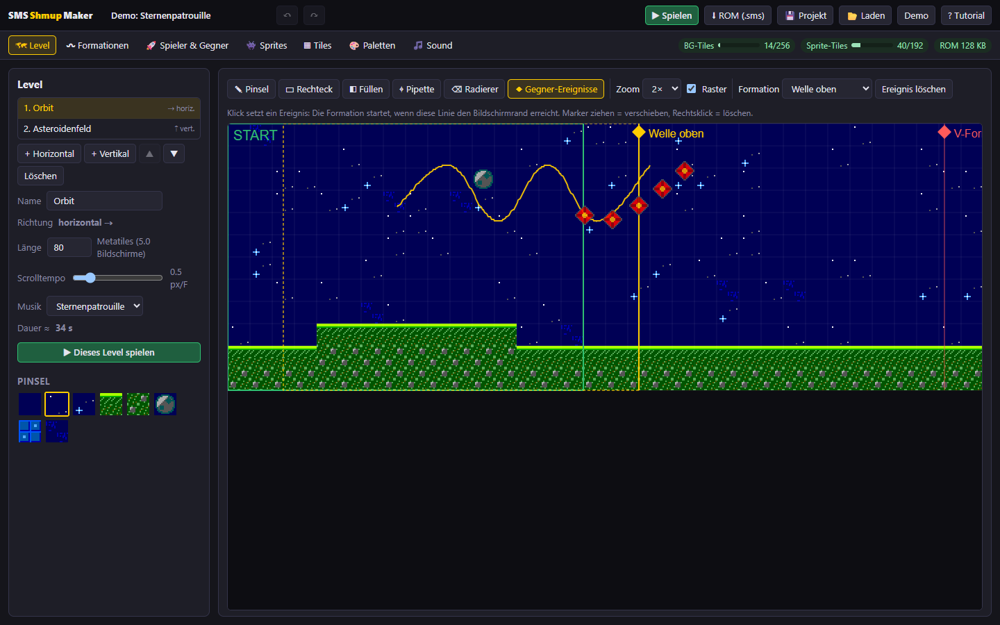
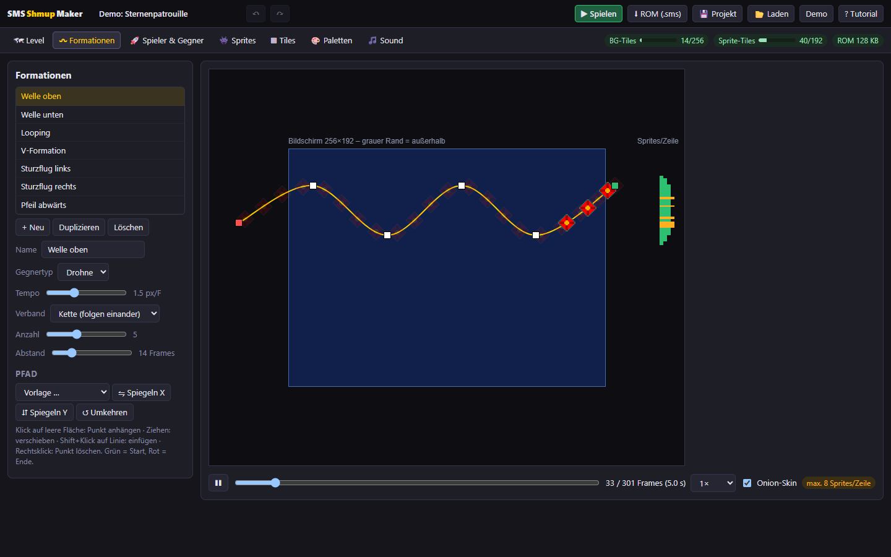
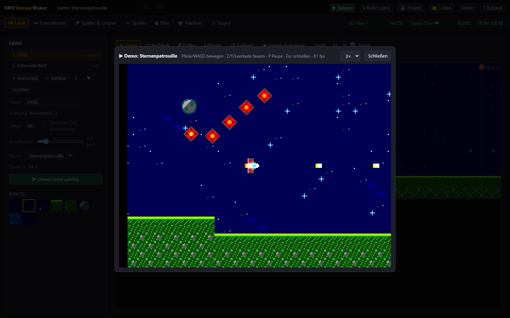
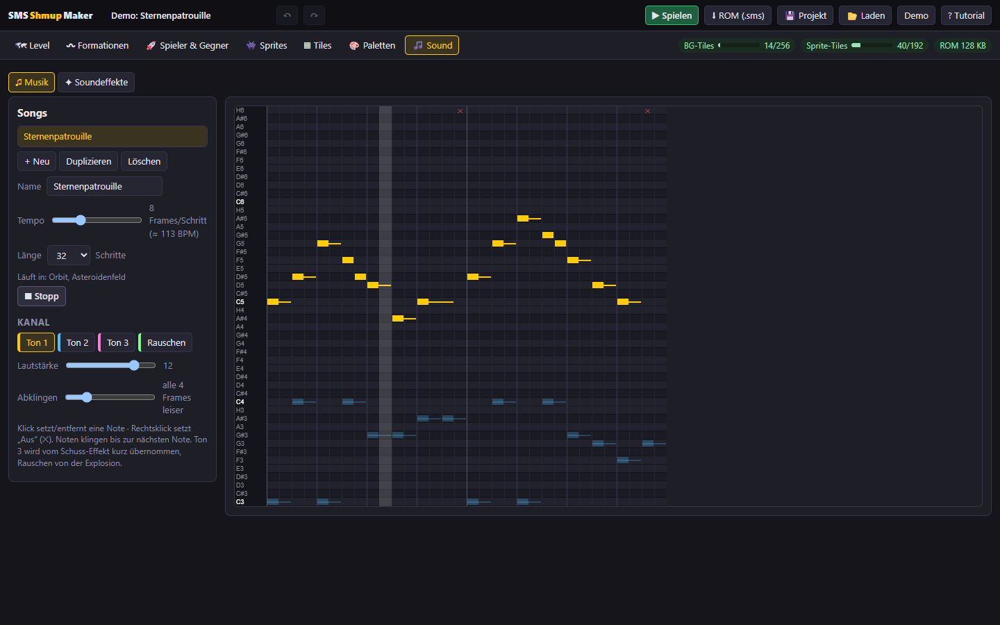

# Shootmaster – SMS Shmup Maker

Ein webbasierter Editor für **Shoot 'em Ups auf dem Sega Master System**. Grafik, Gegnerwellen, Level und Sound baust du im Browser. Am Ende lädst du eine echte `.sms`-ROM herunter, die in Emulatoren und auf Original-Hardware (z. B. Everdrive) läuft.

**▶ Direkt im Browser ausprobieren: https://joergsf4.github.io/shootmaster/**



## Funktionen

- **Level-Editor:** Level scrollen horizontal oder vertikal. Du malst sie mit Pinsel, Rechteck, Füllen und Pipette aus Feldern zu 16×16 Pixeln. Ereignisse setzt du als farbige Marker entlang der Scrollstrecke: Formation, Tempo („Stopp“ hält die Kamera an), Musikwechsel, „Warten, bis alle weg sind“ und Checkpoint (Neustart nach Game Over). Gestapelte Ereignisse an einer Stelle laufen nacheinander ab; „früher“/„später“ ändert die Reihenfolge, beim Ziehen rastet ein Marker an vorhandenen Linien ein. Die angezeigte Spieldauer rechnet Tempo-Ereignisse mit ein. So entsteht ein Boss ohne eigenen Editor: Kamera anhalten, Musik wechseln, zähen Gegner schicken, warten, weiter.
- **Formationen:** Du zeichnest die Flugbahn per Klick. Gegner fliegen als Kette hintereinander oder als starrer Block, zum Beispiel in V-Form. Dazu gibt es Vorlagen, Spiegeln, eine Vorschau mit Zeitleiste und eine Warnung bei zu vielen Sprites pro Bildzeile.
- **Sprites und Pinsel:** Pixel-Editor und Animationen. Hintergrund-Pinsel sind eigenständige 16×16-Bilder; gleiche und gespiegelte 8×8-Teile legt der Editor automatisch zusammen, damit Speicher gespart wird. Alles ist auf die 64 Hardware-Farben der Konsole beschränkt.
- **Spieler und Gegner:** Tempo, Startwaffe, Leben, Lebenspunkte der Gegner und Trefferzonen (Hitboxen). Jeder Gegnertyp hat ein Schussmuster (gerade gegen die Scrollrichtung, gezielt, Fächer aus 3) mit Feuerpause und Tempo; es gilt in jeder Formation und auf jedem Pfad. Gegner schießen nur im Bild, höchstens 16 Gegnerschüsse gleichzeitig.
- **Waffen:** Eigener Tab „Waffen & Power-ups“. Jede Waffe hat bis zu 8 Stufen mit Feuerpause, Schaden und bis zu 5 Austritten (Richtung in 22,5°-Schritten, Versatz), dazu Tempo, Sprite, Hitbox und Durchschlag. Vorlagen: Einzel, Doppel, Fächer, Laser, Rakete, Heck. Die Vorschau zeigt eine Salve horizontal und vertikal; ein Punkt je Stufe zeigt die Rechenzeit (grün passt, gelb kann verlangsamen, rot ist zu teuer und gesperrt). Kapseln und Stufenwechsel im Spiel folgen.
- **Sound:** Musik in einem Noten-Raster (Piano-Roll) mit 3 Tonkanälen und Rauschen, dazu Soundeffekte für Schuss, Explosion und Treffer. Abgespielt wird über den eingebauten Soundchip-Emulator, also so, wie es im Spiel klingt.
- **Spielen im Browser:** Der eingebaute Master-System-Emulator läuft mit Bild und Ton. „▶ Ab hier (P)“ startet am Rand der Ansicht im Level-Editor (blasse Ereignisse liegen davor), „▶ Ab diesem Ereignis“ am gewählten Ereignis; danach folgen die übrigen Level. Im Spiel gibt es Neustart (R) und einen Schalter „Unverwundbar“.
- **Hardware-Grenzen immer sichtbar:** Anzeigen für den Grafikspeicher (256 Hintergrund-Tiles, 192 Sprite-Tiles), die ROM-Größe und die Sprites pro Bildzeile. Ein Problem-Panel („✖ 1 ⚠ 3“) listet fehlende Verweise, zu viele Gegner gleichzeitig und Ähnliches samt kurzem Hinweis, was zu tun ist, und springt per Klick zur Ursache, im Level bis zum Ereignis; bei Fehlern öffnet „▶ Spielen“ diese Liste, statt zu starten.
- **Tutorial:** Eine geführte Tour durch alle Werkzeuge, die beim ersten Start automatisch erscheint.
- Automatisches Speichern im Browser (ungültige Stände werden gesichert statt überschrieben), Rückgängig/Wiederholen auch für Laden, Projekt-Export als JSON. Zahlenfelder übernehmen erst bei Enter oder beim Verlassen (Esc verwirft), ein Undo-Schritt je Eingabe; vor dem Kürzen eines Levels steht da, was abgeschnitten wird. „Neu“ startet mit einer leeren Vorlage (horizontal/vertikal) oder dem Demo-Projekt; eine Checkliste in der Navigation führt durch die ersten Schritte und klappt sich danach zu „✓ Erste Schritte“ ein.

| Formationen | Spielen | Musik |
|---|---|---|
|  |  |  |

## Schnellstart

Voraussetzungen: Node.js 22 und pnpm 9.

```sh
pnpm install
pnpm dev            # Editor unter http://localhost:5173
pnpm test           # Tests: Hardware-Formate, Pfade, ROM, Engine im Emulator, Sound
pnpm build:engine   # Engine neu assemblieren (nur nach Änderungen an engine/src)
```

Steuerung im Spiel: Pfeiltasten oder WASD zum Bewegen, Z, Y oder Leertaste zum Feuern, P für Pause, R für Neustart, Esc zum Schließen. Gamepads werden ebenfalls unterstützt.

## Aufbau

| Ordner | Inhalt |
|---|---|
| [engine/](engine/) | Z80-Engine in Assembler (Scrolling, Gegner, Kollision, Sound-Treiber). Gebaut wird sie mit dem JS-Assembler `z80-asm`, dafür sind weder Docker noch SDCC nötig. |
| [packages/sms-core/](packages/sms-core/) | Projektmodell, Hardware-Formate, Pfad-Backen, Compiler, ROM-Linker, Demo-Projekt |
| [packages/sms-emu/](packages/sms-emu/) | Master-System-Emulator: Z80, Grafikchip (VDP Mode 4), Soundchip (PSG SN76489), Mapper, Joypad |
| [apps/editor/](apps/editor/) | Der Editor (React + Vite) |
| [tools/](tools/) | Headless-Screenshots aus dem ROM und UI-Screenshots über ein lokales Edge/Chrome |
| [docs/](docs/) | [Projektplan](docs/PLAN.md), [Datenformat Engine ↔ Editor](docs/data-format.md), [Tickets](docs/tickets/README.md) |

So entsteht die ROM: Die Engine ist fertig assembliert und belegt Bank 0. Der Editor kompiliert nur die Projektdaten in weitere 16-KB-Banks und schreibt Header und Prüfsumme („TMR SEGA“). Im Browser wird also nichts übersetzt.

## Stand und Grenzen

- Pro Level gibt es bis zu 16 Gegner, 10 Spielerschüsse, 16 Gegnerschüsse und 64 Hardware-Sprites. Liegen mehr als 8 Sprites in einer Bildzeile, flackern sie, statt zu verschwinden. Viele Gegner und viele Schüsse zugleich verlangsamen das Spiel (wie auf der echten Konsole); das Problem-Panel schätzt die Rechenzeit je Level und meldet „kann verlangsamen“ (Warnung) oder „zu viel Rechenzeit“ (Fehler).
- Gegnerschüsse fliegen durch tödliche Pinsel hindurch.
- Es fehlt noch: Anzeige von Punkten und Leben, Kapseln/Power-ups im Spiel (Waffen mit Stufen gibt es, gespielt wird Stufe 1 der Startwaffe), ein eigener Boss-Editor (Bosse lassen sich aus Ereignissen zusammensetzen), Wände, die nur blockieren statt zu töten, Titelbild und der Import von Musik oder PNG-Grafiken. Siehe [Tickets](docs/tickets/README.md).
- Getestet ist die ROM bisher mit dem eingebauten Emulator. Ein Test auf echter Hardware steht noch aus.

## Lizenz

[MIT](LICENSE)
